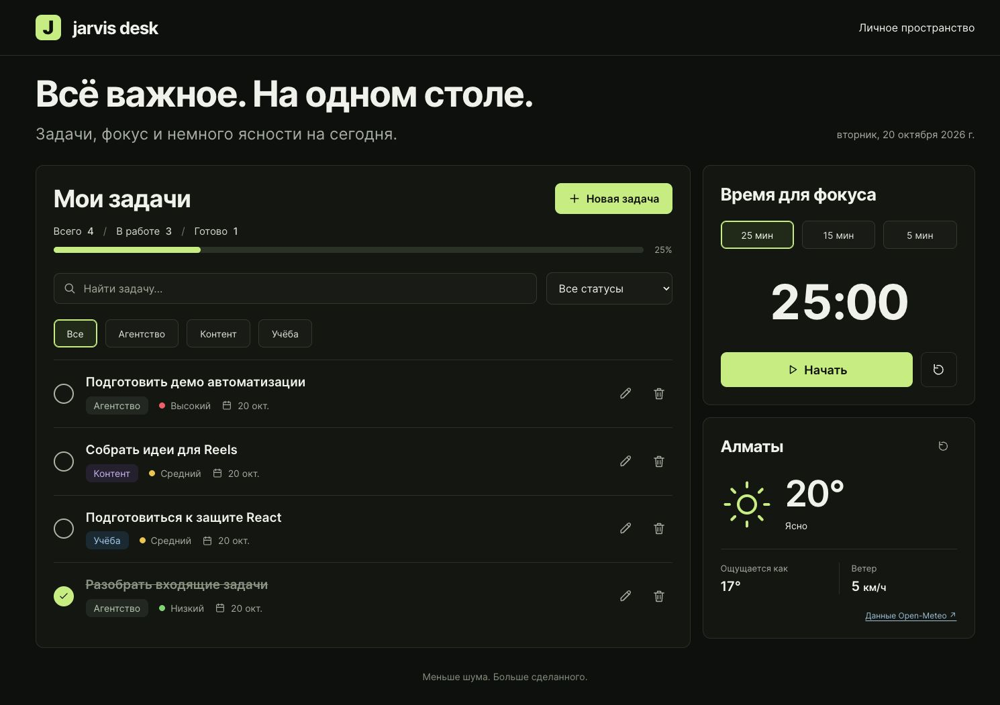

# Jarvis Desk

Личное пространство для задач агентства, контента и учёбы: список дел, прогресс, таймер фокуса и текущая погода в Алматы.

Индивидуальный учебный проект на React для мидтерма и задания **Task 4. Effects**.

**Приложение:** [tamerlanta.github.io/jarvis-desk](https://tamerlanta.github.io/jarvis-desk/)

**Репозиторий:** [TamerlanTA/jarvis-desk](https://github.com/TamerlanTA/jarvis-desk)



## Возможности

- Создание, редактирование, удаление с подтверждением и отметка выполнения задач.
- Направления «Агентство», «Контент», «Учёба»; приоритет и срок каждой задачи.
- Проверка названия (3–120 символов), реальной календарной даты, направления и приоритета.
- Поиск с задержкой 300 мс, фильтры по направлению и статусу; фильтры работают вместе.
- Общая статистика и процент выполненных задач, вычисляемые из списка.
- Сохранение задач между перезагрузками через `localStorage`.
- Четыре демонстрационные задачи при первом запуске. После удаления всех задач пустой список сохраняется.
- Таймер на 5, 15 или 25 минут: старт, пауза, продолжение, сброс и сообщение о завершении.
- Погода в Алматы: температура, ощущаемая температура, описание и ветер; загрузка, ошибка, повтор запроса и ручное обновление.
- Адаптивная раскладка, видимый фокус клавиатуры, подписи полей и кнопок; диалоги закрываются через Escape.

## Стек и запуск

React, Vite, JavaScript, plain CSS. Для проверок — ESLint, Vitest и React Testing Library. Для публикации — `gh-pages`.

Проверено с Node.js **26.0.0** и npm **11.12.1**.

```bash
git clone https://github.com/TamerlanTA/jarvis-desk.git
cd jarvis-desk
npm ci
npm run dev
```

Открыть URL из терминала, обычно `http://localhost:5173/jarvis-desk/`.

```bash
npm test          # 12 проверок Effects и валидации
npm run lint     # JavaScript и правила hooks
npm run build    # production-файлы в dist/
npm run preview  # локальный просмотр production-сборки
```

## Тема курса → где в коде

| Тема | Реализация |
| --- | --- |
| Компоненты | `src/components/`: 10 компонентов, каждый в своём файле; `App.jsx` собирает экран |
| Props | `TaskList` получает задачи и обработчики от `App`; `TaskItem` получает одну задачу; `TaskSummary` получает весь список |
| Lifting state up | `src/App.jsx`: владеет задачами через `useStoredTasks`, передаёт данные в список и сводку; обработчики изменения возвращаются через props |
| Несколько `useState` | `App.jsx`: поиск, направление, статус, открытая форма и выбранные задачи; `TaskForm.jsx`: поля и ошибки; таймер и погода имеют собственный state |
| События | `TaskItem.jsx`: `onChange`, `onClick`; `TaskForm.jsx`: `onSubmit`, `preventDefault`; `TaskFilters.jsx`: изменение поиска и фильтров |
| Controlled forms | `TaskForm.jsx`: `value={values...}` и `onChange={changeField}`; `TaskFilters.jsx`: управляемые input/select |
| Валидация | `src/utils/tasks.js`: `validateTask`, `isValidDate`; `TaskForm.jsx`: ошибки у полей, запрет сохранения невалидных данных |
| Списки и `key` | `TaskList.jsx`: `tasks.map` с `key={task.id}`; `TaskFilters.jsx`, `TaskForm.jsx`, `FocusTimer.jsx`: ключи для вариантов |
| Условный рендеринг | `TaskList.jsx`: пустой список / отсутствие результатов; `WeatherWidget.jsx`: loading / error / data; `App.jsx`: форма и подтверждение удаления |
| Effect №1: чтение `localStorage` | `src/hooks/useStoredTasks.js`, первый `useEffect`, зависимости `[]`: загрузка, проверка структуры и версии данных |
| Effect №2: запись `localStorage` | `src/hooks/useStoredTasks.js`, второй `useEffect`, `[tasks, canSave]`: сохранение только после успешного чтения |
| Effect №3: `fetch` API | `src/components/WeatherWidget.jsx`, `[requestNumber]`: `fetch`, `response.ok`, loading/error, проверка ответа, таймаут, cleanup через `AbortController` |
| Effect №4: таймер | `src/components/FocusTimer.jsx`, `[endsAt]`: интервал обновления остатка времени, cleanup через `clearInterval` |
| Effect №5: debounce | `src/hooks/useDebouncedValue.js`, `[value, delay]`: отложенное обновление поискового запроса, cleanup через `clearTimeout` |
| Адаптивные стили | `src/styles.css`: CSS Grid, Flexbox, media queries, `:focus-visible`, `prefers-reduced-motion` |

Подробный разбор отдельного задания: [Task 4. Effects](docs/EFFECTS.md).

## Архитектура и данные

```text
src/
  App.jsx                       # общий state, обработчики, фильтрация, композиция
  main.jsx                      # createRoot и StrictMode
  components/
    Header.jsx
    TaskSummary.jsx
    TaskFilters.jsx
    TaskList.jsx
    TaskItem.jsx
    TaskForm.jsx
    DeleteDialog.jsx
    FocusTimer.jsx
    WeatherWidget.jsx
    Icon.jsx
  hooks/
    useStoredTasks.js
    useDebouncedValue.js
  utils/
    tasks.js                    # варианты полей, даты, валидация, демо-данные
    weather.js                  # URL API, WMO-коды, проверка ответа
  styles.css
tests/
  effects.test.jsx
```

Поток данных: `App → TaskList → TaskItem`; событие из `TaskItem → обработчик в App → новый tasks → обновление списка и TaskSummary`. Локальный черновик формы попадает в общий список только после успешной валидации.

Сводка и отфильтрованный список вычисляются при рендере. Для них не нужен отдельный state или `useEffect`: это производные данные.

`localStorage` хранит `{ version: 1, tasks: [...] }` под ключом `jarvis-desk.tasks.v1`. У задачи есть стабильный `id`, `title`, `category`, `priority`, `dueDate` и `completed`. Новые ID создаются через `crypto.randomUUID()`.

Данные относятся к этому браузеру и origin: localhost и GitHub Pages имеют разные хранилища. Фильтры и таймер сбрасываются при обновлении страницы. При повреждении хранилища приложение показывает предупреждение и не перезаписывает исходные данные; при отказе записи сообщает об этом пользователю.

## Task 4. Effects: как проверить

1. Добавить задачу, обновить страницу — задача останется. Выполнить её — изменятся сводка и сохранённые данные.
2. Нажать обновление погоды — появится loading, затем актуальный ответ Open-Meteo. Для проверки ошибки включить Offline в DevTools → Network и повторить обновление; вернуть сеть и нажать «Повторить».
3. Выбрать 5 минут, запустить и поставить таймер на паузу — время перестанет уменьшаться; продолжить и сбросить.
4. Ввести запрос поиска — список обновится через 300 мс после последнего ввода.

Автотесты дополнительно проверяют завершение сессии без реального ожидания, очистку интервала после unmount, отмену debounce, чтение перед записью в StrictMode, сохранение пустого списка, повреждённое хранилище, отказ записи, HTTP-ошибку с восстановлением, некорректный ответ API и таймаут запроса.

## GitHub Pages

В `vite.config.js` задан `base: '/jarvis-desk/'`. Приложение одноэкранное, роутер не требуется.

```bash
npm run deploy
```

`predeploy` автоматически выполняет `npm run build`, затем `gh-pages -d dist --nojekyll` публикует `dist/` в ветку `gh-pages`. GitHub → Settings → Pages: **Deploy from a branch → gh-pages → /(root)**. Нужны права записи в репозиторий и настроенная GitHub-аутентификация.

Изменения исходников коммитятся и отправляются в `main` отдельно. Один `git push` не заменяет `npm run deploy`. При переименовании репозитория нужно обновить `base` и ссылки.

## API и источники

Погода: [Open-Meteo Weather Forecast API](https://open-meteo.com/en/docs), координаты Алматы, часовой пояс `Asia/Almaty`, ветер в км/ч. API доступен для некоммерческого использования без ключа; ссылка на источник находится в виджете. Для погоды требуется сеть. Задачи и таймер после загрузки страницы работают независимо от ответа API.

Справка: [React — useEffect](https://react.dev/reference/react/useEffect), [Vite — GitHub Pages](https://vite.dev/guide/static-deploy.html#github-pages).

## Защита и проверка

- [План и текст защиты на 3–4 минуты](docs/DEFENSE.md).
- [Проверки и сравнение интерфейса с макетом](docs/QA.md).
- [Мобильный скриншот](docs/mobile.png).
